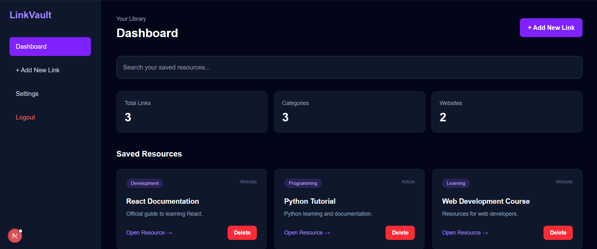
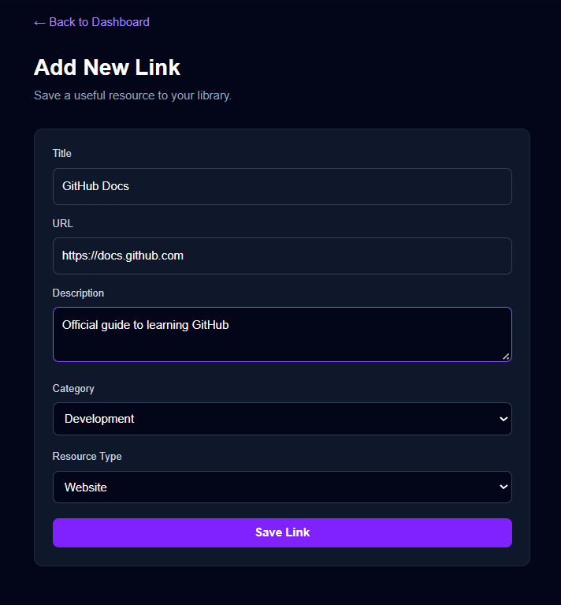

# LinkVault

## Project Overview

LinkVault is a personal knowledge management platform that helps users save, organize, search, and manage useful links, articles, and learning resources in one place.

It provides a centralized dashboard where users can easily access and manage their saved resources.

## Features

- Save useful links and learning resources.
- Organize saved links by category.
- Search resources by title or description.
- Filter saved links by category.
- Add and delete saved links.
- View dashboard statistics.
- Store saved links in the browser using localStorage.
- Reusable React components for a consistent user interface.

## Technologies Used

- Next.js
- React.js
- JavaScript
- Tailwind CSS
- React Context API
- Browser localStorage
- Git and GitHub

## Getting Started

Follow these steps to run the project locally.

### 1. Clone the repository

```bash
git clone https://github.com/ayishashaaza-ui/linkvault.git
```

### 2. Open the project folder

```bash
cd linkvault
```

### 3. Install dependencies

```bash
npm install
```

### 4. Start the development server

```bash
npm run dev
```

### 5. Open in your browser

Visit:

http://localhost:3000

## Project Structure

```text
linkvault/
├── app/             # Application pages
├── components/      # Reusable React components
├── context/         # Shared application state
├── public/          # Static assets
├── package.json     # Project dependencies
└── README.md        # Project documentation
```

## Data Storage

LinkVault currently uses browser localStorage to store saved links. It does not require a backend server or database.

## Screenshots

### Dashboard


### Add New Link


## Project Status

This project is being developed as part of an academic milestone. Features and documentation may be updated as development continues.